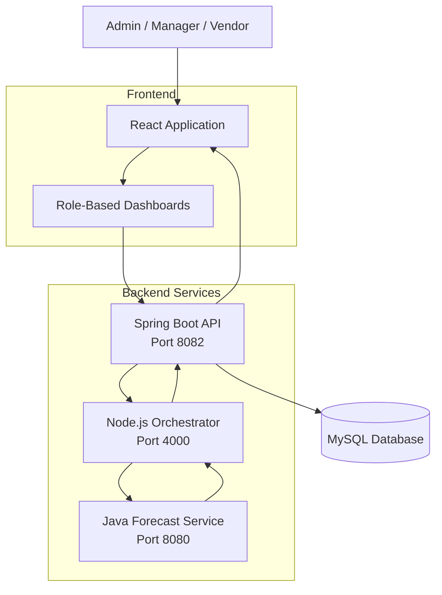

# SmartShelfX

**Inventory Management System with Demand Forecasting and Automated Restocking**

SmartShelfX is an inventory management application developed during the Infosys Springboard Virtual Internship. It helps administrators and managers monitor stock, forecast future demand, and manage purchase orders through role-based dashboards.

## Key Features

- **Demand Forecasting:** Estimates future inventory requirements using historical stock transactions.
- **Automated Restocking:** Generates purchase order suggestions when inventory falls below required levels.
- **Inventory Management:** Tracks stock movements, including IN and OUT transactions.
- **Purchase Order Management:** Supports purchase order creation, approval, and dispatch workflows.
- **Role-Based Access:** Separate dashboards for Admin, Manager, and Vendor.
- **Notifications:** Provides stock alerts and purchase order updates.

## Tech Stack

| Layer | Technologies |
|---|---|
| Frontend | React 18, Chart.js, Axios |
| Main Backend | Java 17, Spring Boot 3.1.5 |
| Orchestration | Node.js, Express |
| Forecasting Service | Java, Spring Boot, Weka |
| Database | MySQL 8.0 |
| Authentication | JWT |
| Build Tools | Maven, npm |

## System Architecture



## Project Structure

```text
SmartShelfX/
│
├── backend/
│   ├── smartshelfx-backend/
│   ├── node-backend/
│   └── java-forecast-service/
│
├── frontend/
│   └── smartshelfx-frontend/
│
├── .gitignore
├── LICENSE
├── README.md
└── SmartShelfX.pptx
```

## Getting Started

### Prerequisites

- Java 17
- Node.js and npm
- MySQL 8.0
- Maven

### 1. Clone Repository

```bash
git clone https://github.com/Chethan13032005/SmartShelfX.git

cd SmartShelfX
```

### 2. Configure Database

Create the MySQL database and configure the database credentials in the Spring Boot application properties.

Database name:

```text
smartshelfx
```

### 3. Start Main Backend

```powershell
cd backend\smartshelfx-backend

.\mvnw.cmd spring-boot:run
```

Runs at `http://localhost:8082`.

### 4. Start Frontend

Open another terminal:

```powershell
cd frontend\smartshelfx-frontend

npm install
npm start
```

Runs at `http://localhost:3000`.

### 5. Start Optional Services

**Node.js Orchestrator**

```powershell
cd backend\node-backend

npm install
cp .env.example .env
npm run dev
```

Runs at `http://localhost:4000`.

**Java Forecasting Service**

```powershell
cd backend\java-forecast-service

.\mvnw.cmd spring-boot:run
```

Runs at `http://localhost:8080`.

## API Overview

| Service | Endpoint | Purpose |
|---|---|---|
| Spring Boot | `POST /api/auth/login` | Authentication |
| Spring Boot | `GET /api/forecast/all` | Retrieve forecasts |
| Spring Boot | `POST /api/forecast/run` | Run demand forecasting |
| Spring Boot | `GET /api/po/suggested` | Retrieve restock suggestions |
| Spring Boot | `GET /api/notifications` | Retrieve notifications |
| Node.js | `POST /api/forecast/run` | Trigger forecasting workflow |
| Node.js | `POST /api/po/auto` | Create purchase orders |
| Java Forecast | `POST /forecast/predict` | Generate demand predictions |

## Demand Forecasting

The forecasting module describes the following techniques:

- Moving Average
- Exponential Smoothing
- Trend Analysis
- Seasonal Pattern Detection
- Volatility Calculation
- Confidence Scoring

## Project Information

**Project:** SmartShelfX

**Internship:** Infosys Springboard Virtual Internship 6.0

**Domain:** Full-Stack Development | Inventory Management | Demand Forecasting

**Repository:** [GitHub - SmartShelfX](https://github.com/Chethan13032005/SmartShelfX)

**License:** MIT
